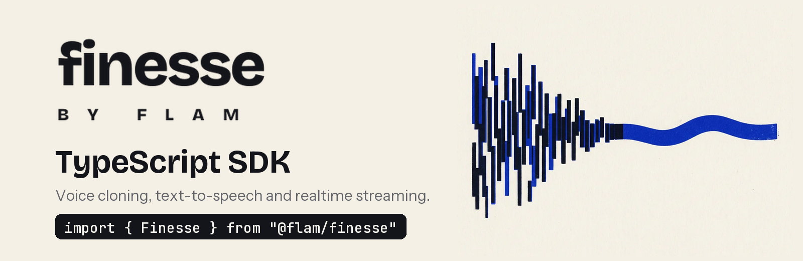
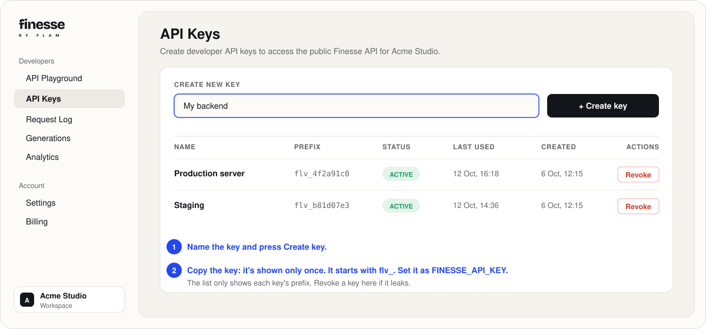
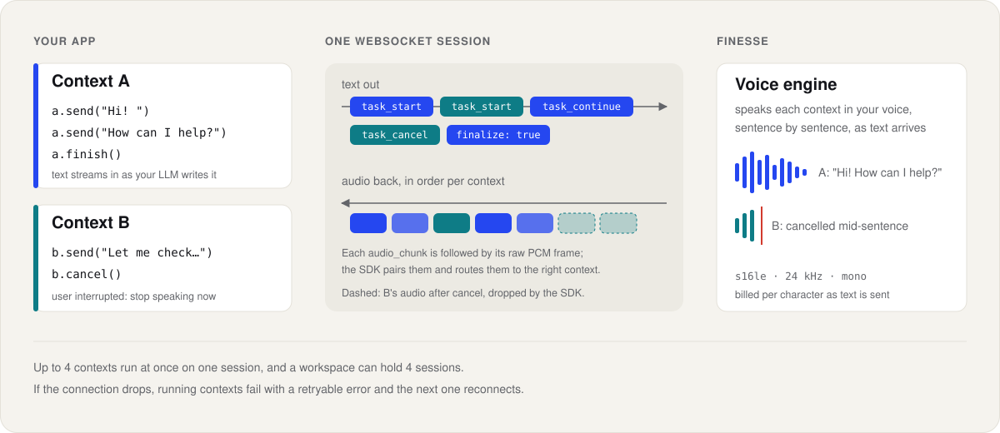

<picture>
  <source media="(prefers-color-scheme: dark)" srcset="./.github/assets/banner-node-dark.png">
  <source media="(prefers-color-scheme: light)" srcset="./.github/assets/banner-node-light.png">
  
</picture>

<p>
  
  
  
  
</p>

# Finesse TypeScript SDK

The official TypeScript and JavaScript library for [Finesse](https://finesse.flamapp.ai), Flam's
voice platform. Clone a voice from a few seconds of audio, turn text into speech in that voice,
and stream it in realtime to voice agents, with a few lines of code.

- **Typed** end to end, ESM and CommonJS, no heavy dependencies (it uses the built-in `fetch`).
- **Realtime** over one WebSocket: stream text in as your LLM writes it, get audio back, cancel
  on barge-in.
- **Safe by default**: retries that never double-bill, typed errors, timeouts, `AbortSignal`.

**[Documentation](https://finesse.flamapp.ai/guides/overview)** ·
**[API reference](https://finesse.flamapp.ai/voice-api/list-voices)** ·
**[Dashboard](https://finesse.flamapp.ai/dashboard)** ·
**[Changelog](./CHANGELOG.md)**

## Contents

- [Installation](#installation)
- [Get an API key](#get-an-api-key)
- [Quickstart](#quickstart)
- [Voices](#voices)
- [Clone a voice](#clone-a-voice)
- [Text to speech](#text-to-speech)
- [Streaming speech](#streaming-speech)
- [Realtime](#realtime)
- [Browsers and short-lived tokens](#browsers-and-short-lived-tokens)
- [Which method should I use?](#which-method-should-i-use)
- [Audio formats](#audio-formats)
- [Handling errors](#handling-errors)
- [Retries](#retries)
- [Timeouts and cancellation](#timeouts-and-cancellation)
- [Per-request options](#per-request-options)
- [Request IDs](#request-ids)
- [Advanced](#advanced)
- [Runtimes](#runtimes)

## Installation

Realtime in Node also needs the `ws` package:

```sh
npm install @flamai/finesse ws
# or
pnpm add @flamai/finesse ws
```

## Get an API key

1. Sign in to the [Finesse dashboard](https://finesse.flamapp.ai/dashboard).
2. Open **Settings → API keys** and create a key. Copy it right away: it is shown only once,
   and it starts with `flv_`.
3. Put it in your environment, where the SDK finds it:

```sh
export FINESSE_API_KEY="flv_..."
```

Keep the key on your server. Anyone who has it can spend your workspace's credits.

<p align="center">
  
</p>

## Quickstart

```ts
import { writeFile } from "node:fs/promises";
import { Finesse, isReady } from "@flamai/finesse";

const client = new Finesse(); // reads FINESSE_API_KEY

// Pick any voice you can use: your own, or one from the public catalog.
let voiceId = "";
for await (const voice of client.voices.list()) {
  if (isReady(voice)) {
    voiceId = voice.id;
    break;
  }
}

const audio = await client.speech.create({ voice_id: voiceId, text: "Hello from Finesse!" });
await writeFile("hello.wav", audio.data);
```

`hello.wav` is a 24 kHz WAV file. That's it.

## Voices

`voices.list()` returns your voices first (newest first), then the public platform voices.
`for await` walks every page for you.

```ts
for await (const voice of client.voices.list()) {
  console.log(voice.id, voice.name, voice.status, voice.language, voice.labels);
}

const voice = await client.voices.get("665f1a2b3c4d5e6f7a8b9c0d");
await client.voices.update(voice.id, { name: "Narrator (UK)", labels: { accent: "british" } });
await client.voices.delete(voice.id);
```

Just the first page, with its totals:

```ts
const page = await client.voices.list({ page_size: 20 });
console.log(
  page.total,
  page.has_more,
  page.voices.map((v) => v.name),
);
```

A voice can speak once `voice.status === "ready"` (`isReady(voice)`). Its `alias` (for example
`narrator`) also works as the `voice` on the
[OpenAI-compatible endpoint](https://finesse.flamapp.ai/voice-api/openai-compatible).

Request and response fields use the API's own names (`voice_id`, `output_format`,
`page_size`), so they match the API reference exactly.

## Clone a voice

Upload a clean reference clip of one speaker (10-30 seconds of clear speech works best; at least
10 seconds, at most 20 MiB) and wait for the voice to be ready. Cloning requires
`consent: true`: you attest that you are the speaker or hold their explicit permission to clone
their voice, and the attestation is recorded on the voice.

```ts
import { fileFromPath } from "@flamai/finesse";

const voice = await client.voices.cloneAndWait(
  {
    name: "Ana",
    file: await fileFromPath("reference.wav"), // or a Blob/File, bytes, or { data, filename }
    consent: true,
    language: "en",
    labels: { gender: "female", accent: "british" },
    ref_text: "What the speaker says in the clip, if you have it.",
  },
  { onUpdate: (job) => console.log("clone job:", job.status) },
);
```

`cloneAndWait` creates the voice, uploads the clip, and polls the clone job until it finishes.
The first clone after the cloner has been idle can take a couple of minutes. To start the clone
now and wait later:

```ts
const clone = await client.voices.clone({
  name: "Ana",
  file: await fileFromPath("reference.wav"),
  consent: true,
});
console.log(clone.voice.status, clone.job_id); // "processing", "6660aa00..."
const ready = await client.voices.waitUntilReady(clone, { timeout: 300_000 });
```

Cloning throws `CloneFailedError` if the job fails and `CloneTimeoutError` if it doesn't finish
in time. To add a clip to a voice you already created, use
`client.voices.enroll(voiceId, { file, consent: true })`.

## Text to speech

`speech.create` returns the whole clip in one response (up to 10,000 characters of text):

```ts
const audio = await client.speech.create({
  voice_id: voice.id,
  text: "The quick brown fox jumps over the lazy dog.",
  language: "en", // optional; defaults to the voice's language
  output_format: "wav", // default; or raw PCM: "s16le", "s24le", "s32le", "f32le", "f64le"
  num_step: 32, // optional; 1-32, default 32; fewer steps is faster
});

audio.data; // Uint8Array
audio.contentType; // "audio/wav"
audio.sampleRate; // 24000
audio.generationId; // id of this clip in your generation history
audio.audioURL; // stored copy of the clip, when storage is enabled (may be short-lived)
```

Identical requests are served from a cache at no charge. Speech is billed per character of
`text`.

## Streaming speech

`speech.stream` sends audio as it is generated, so playback can start before the whole clip is
ready. Chunks are raw PCM (`s16le`, 24 kHz, mono, unless you set `output_format`).

```ts
const stream = client.speech.stream({ voice_id: voice.id, text: "Hello, streamed." });
for await (const chunk of stream) {
  speaker.write(chunk.pcm);
}
console.log(stream.done?.audio_duration_s, stream.done?.generation_id);
```

Or collect everything: `const pcm = await client.speech.stream({ ... }).readAll();`

Errors before the stream starts throw the usual errors (for example `PaymentRequiredError`).
A failure after it starts throws `StreamError`.

## Realtime

Realtime is for voice agents and anything conversational. One session is one WebSocket. You
send text as it is produced and get audio back as fast as the engine makes it. Each turn of
speech runs in a **context**, and a session can run several contexts at once.

<p align="center">
  
</p>

```ts
const rt = await client.realtime.connect();

for await (const event of rt.say({ voice_id: voiceId, text: "Hi! How can I help you today?" })) {
  if (event.type === "audio") speaker.write(event.pcm); // s16le, 24 kHz, mono
}

await rt.close();
```

### Stream text from an LLM

Send text a token or a sentence at a time, then `finish()` the turn:

```ts
const ctx = rt.context({ voice_id: voiceId });

const playing = (async () => {
  for await (const pcm of ctx.audio()) speaker.write(pcm);
})();

for await (const token of llm.stream(prompt)) await ctx.send(token);
await ctx.finish();
await playing;
```

### Interruptions (barge-in)

When the user starts talking, cancel the turn. Audio still on its way for that context is
dropped, and iterating the context ends with a `task_cancelled` event.

```ts
await ctx.cancel();
```

### Events

Iterating a context yields events you can narrow on `type`:

| `type`             | When                                                                   |
| ------------------ | ---------------------------------------------------------------------- |
| `"task_started"`   | The turn began. Has the `sample_rate` and `audio_format` of its audio. |
| `"audio"`          | A chunk of audio: `pcm`, `sentence_index`, `chunk_index`.              |
| `"sentence_done"`  | A sentence finished: `text`, `audio_duration_s`.                       |
| `"task_done"`      | The turn finished (last event): `total_audio_duration_s`.              |
| `"task_cancelled"` | The turn was cancelled (last event).                                   |
| `"unknown"`        | An event this SDK version doesn't know yet: `event_type`, `data`.      |

A turn that fails throws `RealtimeError` (for example `code === "voice_not_found"`).

### Limits and reconnects

- A session runs up to 4 contexts at once, and holds one of your plan's concurrent-synthesis
  slots until it closes. Opening one more than the plan allows throws `RateLimitError` with
  `code === "concurrency_limited"` (wait `error.retryAfter` seconds), so reuse a session.
- If the connection drops, running contexts throw `RealtimeError`. Check `error.retryable`. The
  next context reconnects automatically (turn this off with `connect({ autoReconnect: false })`).
- Running out of credits ends the session with `RealtimeError` (`code === "insufficient_credits"`).
- Text is billed per character as it is sent. A session reserves credits in blocks of up to
  1,000 characters and returns what it doesn't use when it ends.

## Browsers and short-lived tokens

Never ship an API key to a browser. Your server mints a short-lived, single-use token with a key
that has the `tts` scope, and returns only the token:

```ts
// On your server
const { token } = await client.tokens.create({ ttl_seconds: 60, voice_ids: [voiceId] });
```

In the browser, the client runs without `dangerouslyAllowBrowser` when it holds a token:

```ts
const getToken = async () => (await (await fetch("/api/finesse-token")).json()).token;

// One-shot speech: sent as "Authorization: Bearer fin_tok_..."
const tts = new Finesse({ accessToken: await getToken() });
const audio = await tts.speech.create({ voice_id: voiceId, text: "Hi!" });

// Realtime: the token rides in the WebSocket subprotocol list. A token is spent by the
// handshake that uses it, so pass getAccessToken for reconnects to fetch a fresh one.
const live = new Finesse({ accessToken: await getToken() });
const rt = await live.realtime.connect({ getAccessToken: getToken });
```

A token carries the `tts` scope only, works for one `speech.create` / `speech.stream` call or one
realtime session, and dies when the key that minted it is revoked or expires. A request refused
before it runs (a `429`, a plan check) keeps its token, so you can retry with it. A spent,
expired or unknown token throws `AuthenticationError` with `code === "token_invalid"`; a voice
outside `voice_ids` throws `PermissionDeniedError` with `code === "voice_not_allowed"`.

## Which method should I use?

| You want to...                                         | Use             | Why                                                                   |
| ------------------------------------------------------ | --------------- | --------------------------------------------------------------------- |
| Make an audio file, or speak a fixed piece of text     | `speech.create` | Simplest. One request, one clip, cached.                              |
| Start playback fast for a known piece of text          | `speech.stream` | Audio starts before the clip is finished.                             |
| Build a voice agent, or speak text as an LLM writes it | `realtime`      | Text in, audio out, many turns on one connection, cancel on barge-in. |

## Audio formats

| `output_format`  | What you get                         | Default for               |
| ---------------- | ------------------------------------ | ------------------------- |
| `wav`            | WAV file                             | `speech.create`           |
| `s16le`          | Raw PCM, 16-bit signed little-endian | `speech.stream`, realtime |
| `s24le`, `s32le` | Raw PCM, 24- or 32-bit signed        |                           |
| `f32le`, `f64le` | Raw PCM, 32- or 64-bit float         |                           |
| `opus`           | Opus                                 | realtime only             |

All audio is mono. The engine's native rate is 24 kHz. You can ask for a higher `sample_rate`,
but lower ones still come back at 24 kHz, so always read the actual rate from
`audio.sampleRate`, `stream.sampleRate` or the `task_started` event.

## Handling errors

Every error extends `FinesseError`. HTTP errors carry `status`, `message`, a machine-readable
`code` when the API sends one, and `billingRemaining`.

```ts
import {
  APIConnectionError,
  APIStatusError,
  PaymentRequiredError,
  RateLimitError,
} from "@flamai/finesse";

try {
  await client.speech.create({ voice_id: voice.id, text: "Hello!" });
} catch (err) {
  if (err instanceof PaymentRequiredError)
    console.log("Out of credits:", err.code, err.billingRemaining);
  else if (err instanceof RateLimitError) console.log("Slow down and retry.");
  else if (err instanceof APIStatusError) console.log(err.status, err.message);
  else if (err instanceof APIConnectionError) console.log("Could not reach Finesse.");
  else throw err;
}
```

| Error                                   | Status | When                                                                                                            |
| --------------------------------------- | ------ | --------------------------------------------------------------------------------------------------------------- |
| `BadRequestError`                       | 400    | Invalid input, text over 10,000 characters, voice not enrolled                                                  |
| `AuthenticationError`                   | 401    | Missing, unknown or revoked key; `key_expired`; `token_invalid`                                                 |
| `PaymentRequiredError`                  | 402    | `insufficient_credits`, `quota_exhausted` or `payment_required`                                                 |
| `PermissionDeniedError`                 | 403    | `insufficient_scope`, `voice_not_allowed` (token), `feature_disabled`, or `plan_limit_reached` (see `.feature`) |
| `NotFoundError`                         | 404    | No such voice or job, or not visible to your workspace                                                          |
| `ConflictError`                         | 409    | A request with the same `Idempotency-Key` is still running                                                      |
| `PayloadTooLargeError`                  | 413    | Request body over 21 MiB                                                                                        |
| `UnprocessableEntityError`              | 422    | `invalid_input`, or `idempotency_key_reused`                                                                    |
| `RateLimitError`                        | 429    | `rate_limited` / `concurrency_limited` (see `retryAfter`), or `too_many_sessions`                               |
| `InternalServerError`                   | 5xx    | `upstream_error` (502), `upstream_busy` / `unavailable` (503, see `retryAfter`) or `internal_error`: retry      |
| `APIConnectionError`                    |        | No response; `APITimeoutError` when it timed out                                                                |
| `StreamError`                           |        | A speech stream failed after it started                                                                         |
| `RealtimeError`                         |        | A realtime context or session failed                                                                            |
| `CloneFailedError`, `CloneTimeoutError` |        | Waiting for a clone                                                                                             |

## Retries

Failed requests are retried twice with exponential backoff, honouring `Retry-After`: network
errors, timeouts, 408, 429 and 5xx.

Calls that create something or cost credits (`speech.create`, `voices.create`, `voices.clone`,
`voices.enroll`) send an `Idempotency-Key`, the same one on every retry, so the service runs
them at most once. The SDK retries them this way only once the service has confirmed it
honours keys (it echoes the key back); against a service that doesn't, they keep the cautious
rules below, so nothing can run twice. A retry of a clone that already succeeded gets the first result back, and a
retried synthesis is served from the cache at no charge. If the first attempt is still running,
the SDK waits for it (up to the request timeout) without using up a retry. To choose the key
yourself, pass `{ headers: { "Idempotency-Key": "..." } }`.

`speech.stream` has no key, so it is only retried when the server certainly did no work: the
connection never opened, 429, 502 or 503. These are also the rules for keyed calls until the
service confirms it honours keys.

With an `accessToken`, only a `429` or a connection that never opened is retried. The service
spends the token just before running the request, so a retry after anything later would only
get `token_invalid`; the original error is thrown instead.

```ts
const client = new Finesse({ maxRetries: 5 }); // every request
await client.speech.create({ voice_id, text: "Hello!" }, { maxRetries: 0 }); // one request
```

## Timeouts and cancellation

Requests time out after 120 seconds. Synthesis on a cold engine can take a while to start, so
keep this generous. For streams the timeout is the longest wait between chunks, not the whole
stream. A timeout throws `APITimeoutError`.

```ts
const client = new Finesse({ timeout: 60_000 }); // ms, every request
await client.voices.get(voiceId, { timeout: 10_000 }); // one request
```

Pass an `AbortSignal` to stop a request, its retries, and any waiting. The promise rejects with
the signal's reason:

```ts
const controller = new AbortController();
setTimeout(() => controller.abort(), 5_000);
await client.speech.create({ voice_id, text: "Hello!" }, { signal: controller.signal });
```

## Per-request options

Every request method takes `{ signal, timeout, maxRetries, headers }` as its last argument, for
that call only:

```ts
await client.speech.create(
  { voice_id, text: "Hello!" },
  { timeout: 30_000, maxRetries: 0, headers: { "X-Request-Id": "abc-123" } },
);
```

On `jobs.wait`, `voices.waitUntilReady` and `voices.cloneAndWait`, `timeout` means the overall
time to wait for the clone.

## Request IDs

Every response has an `X-Request-Id`. Errors carry it as `error.requestId`; quote it when you
contact support.

```ts
try {
  await client.voices.get("665f1a2b3c4d5e6f7a8b9c0d");
} catch (err) {
  if (err instanceof NotFoundError) console.log(err.requestId); // "req_3f9c..."
}
```

## Advanced

### Raw responses

`client.withRawResponse` has the same methods and resolves to the HTTP response with the result:

```ts
const {
  data: audio,
  status,
  requestId,
  headers,
} = await client.withRawResponse.speech.create({
  voice_id,
  text: "Hello!",
});
console.log(status, requestId, headers.get("x-sample-rate"));
```

### Logging

Set `FINESSE_LOG=debug` (or pass `logLevel: "debug"`) to log every request (method, URL, status,
timing, request id), or `info` to log only retries. Pass `logger` to send the lines somewhere
other than `console`. The SDK never logs your API key, request bodies or audio.

### Copying a client with other defaults

```ts
const quick = client.withOptions({ timeout: 10_000, maxRetries: 0 });
await quick.voices.get(voiceId);
```

### Environments

The client talks to production by default. Point it elsewhere with `baseURL` or
`FINESSE_BASE_URL`:

```ts
const client = new Finesse({ baseURL: "https://finesse-proxy.example.com" });
```

### Configuration

| Option                    | Environment variable | Default                               |
| ------------------------- | -------------------- | ------------------------------------- |
| `apiKey`                  | `FINESSE_API_KEY`    | required, unless `accessToken`        |
| `accessToken`             |                      | none (a short-lived `fin_tok_` token) |
| `baseURL`                 | `FINESSE_BASE_URL`   | `https://fi.production.flamapis.com`  |
| `timeout`                 |                      | 120 000 ms                            |
| `maxRetries`              |                      | 2                                     |
| `defaultHeaders`          |                      | none                                  |
| `fetch`                   |                      | the global `fetch`                    |
| `dangerouslyAllowBrowser` |                      | `false`                               |
| `logLevel`                | `FINESSE_LOG`        | `"off"`                               |
| `logger`                  |                      | `console`                             |

### Custom fetch

Pass your own `fetch` for proxies, logging or tests:

```ts
const client = new Finesse({ fetch: myFetch });
```

### Attribution

Requests identify the SDK with an `X-Finesse-Client` header. If you build an integration on top
of the SDK, name it so it shows up in your usage analytics:

```ts
const client = new Finesse({ defaultHeaders: { "X-Finesse-Client": "my-app/1.0.0" } });
```

## Runtimes

| Runtime  | HTTP               | Realtime                                                |
| -------- | ------------------ | ------------------------------------------------------- |
| Node 18+ | built-in `fetch`   | needs `ws`; the API key goes in a header                |
| Bun      | built-in           | built-in `WebSocket`; the API key goes in a header      |
| Deno     | built-in           | built-in `WebSocket`; from 2.5 the key goes in a header |
| Browsers | with `accessToken` | built-in `WebSocket`; the token is a subprotocol        |

Browsers can't keep an API key secret, so a client holding a key refuses to run in one. Use a
[short-lived token](#browsers-and-short-lived-tokens) instead. For internal tools only,
`new Finesse({ dangerouslyAllowBrowser: true })` lifts this; realtime then sends the key in a
deprecated URL parameter, because browsers can't set WebSocket headers (as does Deno before
2.5), and logs a warning once.

## Examples

Runnable scripts are in [`examples/`](./examples): [`speak.ts`](./examples/speak.ts) and
[`realtime.ts`](./examples/realtime.ts).

## Versioning

The SDK follows [semantic versioning](https://semver.org). Before 1.0, minor versions may
include breaking changes; they are listed in the [changelog](./CHANGELOG.md).

```ts
import { VERSION } from "@flamai/finesse";
```

## Contributing

```sh
pnpm install
pnpm test                  # unit tests, no network
pnpm typecheck && pnpm lint && pnpm build
```

Contract tests run against a real API (they synthesize a few short sentences, which is billed)
and refuse to run against production:

```sh
FINESSE_LIVE=1 FINESSE_API_KEY=flv_... \
FINESSE_BASE_URL=<non-production API URL> pnpm vitest run tests/live
```
